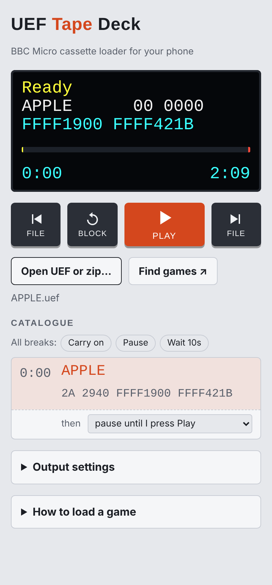

# UEF Tape Deck

**Load a BBC Micro from your phone.** A web page that plays UEF tape images out of your phone's headphone socket, straight into the BBC's cassette port — like a cassette recorder, but with a catalogue, block rewind and every game you own in your pocket.

### [▶ Open the Tape Deck](https://d8fydd73-beep.github.io/uef-tape-deck/)

Nothing to install: open the link on your phone (Chrome works best), add it to your home screen if you like, and plug in.

## What you need

- A phone with a headphone socket, or a USB-C to 3.5 mm adapter
- A BBC Micro cassette lead (7-pin DIN at the BBC end, 3.5 mm jack for the phone's output). The motor plug isn't used.

## Loading a game

1. Plug the lead into the phone and into the BBC's cassette socket.
2. Turn on **Do Not Disturb** — a notification sound in the middle of a block causes a load error.
3. Put the phone volume at maximum.
4. On the BBC, type `*TAPE` then `CHAIN""` (BASIC) or `*RUN` (machine code).
5. Tap **Open UEF or zip…**, choose the game, and press **Play**.

If the BBC shows `Data?`, `Block?` or `Header?`, press **Block** to rewind one block — the BBC picks it up again.

## Features

- Reads **.uef** files, gzip-compressed or not, and **.zip** files straight from game archives (no need to extract them)
- A **catalogue** of every file on the tape, like `*CAT`, with block counts, lengths and load/exec addresses
- **Block** rewind for load errors, and previous/next **file** buttons for multi-part games
- At the end of each file or long gap the deck can **carry on**, **pause** until you press Play, or **wait** a few seconds — set per break, and remembered for each tape
- A **scrub bar** to move anywhere on the tape
- **Output settings** for awkward machines: level, square wave instead of sine, inverted polarity
- Keeps the phone's screen awake while playing
- Includes a short demo tape, so you can test the lead straight away

## Getting games

**Find games** opens [Stairway to Hell](https://www.stairwaytohell.com/), the big archive of BBC Micro tape images. Download a game's zip, then open it in the deck.

Or try [**Chuckie Apple**](https://github.com/d8fydd73-beep/chuckie-apple) — the Chuckie Egg sequel that never was. Its `APPLE.uef` loads in about two minutes with `*TAPE` and `*RUN`.

## How it works

Everything runs in the browser: the UEF file is turned into the BBC's tape tones — 1200 Hz and 2400 Hz cycles at 1200 baud (300 baud tapes too) — by an AudioWorklet, so timing stays steady even while the screen's busy. Block headers are decoded and CRC-checked to build the catalogue. The whole thing is a single `index.html` with no dependencies apart from fonts.

## Ideas for the future

- **Saving:** record the BBC's cassette output through the phone's microphone input and save it as a UEF.

## Credits

Made by **D8fydd-Beep**.
